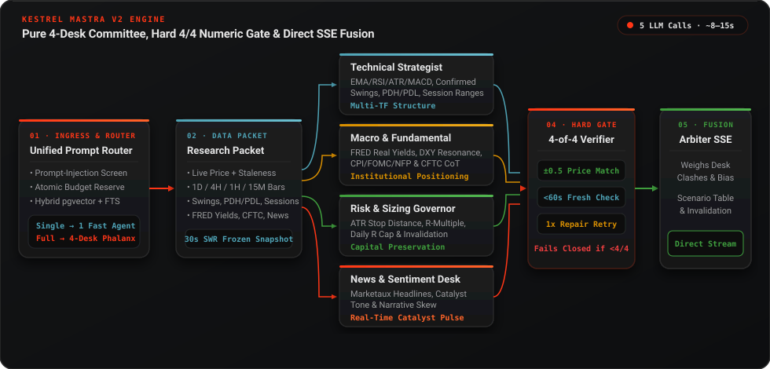
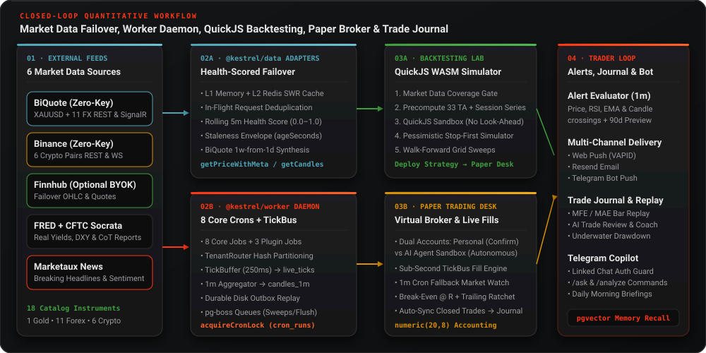
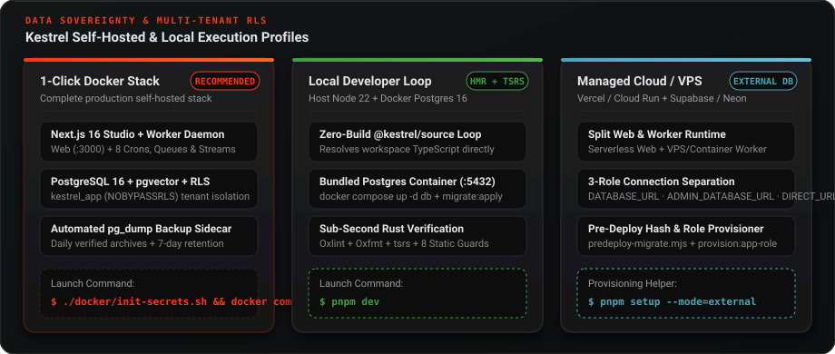
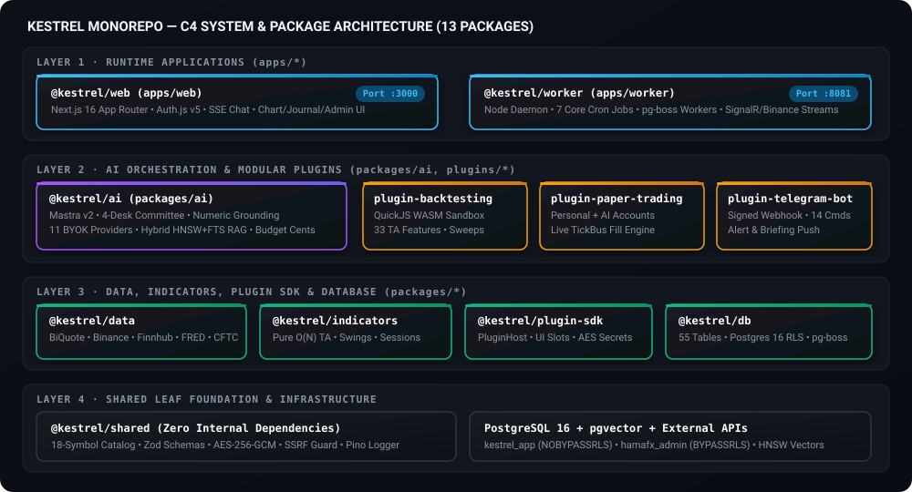

<div align="center">


# KESTREL

### _The Self-Hosted Multi-Agent AI Trading & Quantitative Research Workstation_

<p align="center">
  <strong>4-Desk Mastra Committee • 4/4 Numeric Grounding Gate • QuickJS WASM Backtester • Live Paper Broker • MFE/MAE Journal Replay • Multi-Tenant Postgres RLS</strong>
</p>

<p align="center">
  <a href="https://github.com/HamaFx/Kestrel/actions/workflows/ci-fast.yml"></a>
  <a href="https://nodejs.org/"></a>
  <a href="https://nextjs.org/"></a>
  <a href="https://mastra.ai/"></a>
  <a href="https://www.postgresql.org/"></a>
  <a href="https://www.docker.com/"></a>
  <a href="LICENSE"></a>
</p>

<p align="center">
  <a href="#-why-kestrel">🏛️ Why Kestrel</a> •
  <a href="#-quickstart">⚡ 60s Quickstart</a> •
  <a href="#-4-desk-ai-committee--numeric-grounding">🧠 4-Desk AI Committee</a> •
  <a href="#-closed-loop-quant-workflow--plugins">⚙️ Backtest, Paper & Journal</a> •
  <a href="#-markets-feeds--quantitative-structure">📊 Markets & Math</a> •
  <a href="#-self-hosted-deployment-profiles">🚀 Deployment</a> •
  <a href="#-byok-providers--configuration">🔑 BYOK & Config</a> •
  <a href="#-monorepo-architecture--developer-guide">🛠️ Architecture</a>
</p>

</div>

---

> [!NOTE]
> **Research & Decision-Support Disclaimer:** Kestrel is a self-hosted quantitative research, strategy simulation, and journaling workstation—**not financial advice, a licensed broker-dealer, or a live-money execution engine**. Market feeds can experience latency or outages. Always verify levels independently and manage risk responsibly.

---

## 🏛️ Why Kestrel?

Generic AI chatbots fail traders in three predictable ways: **they hallucinate market prices from training data, they cannot see multi-timeframe candle structure or macro positioning, and they agree with whatever bias you type into the prompt.**

Kestrel replaces ungrounded chat with a **closed-loop quantitative workstation** built for **Gold (`XAUUSD`), 11 Forex pairs, and 6 Crypto pairs**:

```
+---------------------- [ THE KESTREL CLOSED LOOP ] ----------------------+
|                                                                         |
| ●  01 · ingest       zero-key biquote + binance + fred + cftc + news    |
| │                                                                       |
| ●  02 · deliberate   4 parallel specialist desks → 4/4 numeric gate     |
| │                                                                       |
| ●  03 · simulate     quickjs wasm backtester → walk-forward grid sweeps |
| │                                                                       |
| ●  04 · forward-test live tick-matched paper broker (personal + ai)     |
| │                                                                       |
| ●  05 · review       mfe/mae bar replay → underwater dd → ai coach      |
| │                                                                       |
| ○  06 · recall       hybrid pgvector hnsw + full-text longitudinal rag  |
+-------------------------------------------------------------------------+
```

- 🧠 **Pure 4-Desk AI Committee (`@kestrel/ai`)**: Convenes four independent [Mastra](https://mastra.ai) specialist agents (**Technical**, **Macro/Fundamental**, **Risk & Sizing**, and **News/Sentiment**) in parallel over a frozen 30-second market research packet, enforces a **strict 4-of-4 numeric verification gate** (`±0.5` price tolerance + `<60s` staleness check), and streams a conflict-aware **Fusion Arbiter** synthesis over SSE.
- 🧪 **QuickJS WASM Strategy Backtesting Lab (`@kestrel/plugin-backtesting`)**: Executes user-written or AI-authored JavaScript strategies inside a zero-I/O **QuickJS WebAssembly sandbox** (32 MB RAM / 2s CPU cap, strict look-ahead ban) across 33 precomputed TA and session series, with pessimistic stop-first bar fills and walk-forward parameter sweeps.
- 📈 **Dual-Account Paper Trading Broker (`@kestrel/plugin-paper-trading`)**: Forward-tests setups and deployed strategies against sub-second live ticks (`TickBus`) and 1-minute market-watch crons across two isolated `numeric(20,8)` accounts: **Personal Demo** (`$100,000`, human-confirmed in chat) and **AI Agent Sandbox** (`$50,000`, autonomous strategy execution).
- 📓 **R-Multiple Trade Journal, MFE/MAE Replay & AI Coach**: Logs manual and paper trades, replays historical setups bar-by-bar with **Maximum Favorable / Adverse Excursion (`MFE` / `MAE`)** and Execution Efficiency scoring, plots monotone cubic Hermite equity and underwater drawdown curves, and embeds lessons into `pgvector` memory.
- 📱 **Per-User Telegram Copilot (`@kestrel/plugin-telegram-bot`)**: Links a personal `@BotFather` bot in 60 seconds via signed webhooks to receive multi-channel alerts, morning macro briefings, and run `/price`, `/positions`, `/alert`, `/ask`, and `/analyze <symbol> [single|full]` from your phone.
- 🛡️ **Sovereign Multi-Tenant Security (`@kestrel/db`)**: Enforces fail-closed **PostgreSQL 16 Row-Level Security (RLS)** on the non-bypass `kestrel_app` role (`NOBYPASSRLS`), encrypts all user BYOK API keys at rest with **AES-256-GCM**, and reserves AI spend atomically in integer USD cents.

---

## ⚡ Quickstart

### Prerequisites

- **Docker Desktop** or **Docker Engine** (with Docker Compose v2)
- **Node.js `>=22.22.2`** and **pnpm `>=12.0`** _(only required for Option 2 local host development)_

### Option 1: 1-Click Docker Stack (Recommended)

Launches the complete production stack—**Next.js 16 Web Studio (`:3000`)**, **Background Worker Daemon (`:8081`)**, **PostgreSQL 16 + `pgvector` (`:5432`)**, and the **Automated `pg_dump` Backup Sidecar**—with zero paid market-data keys required:

```bash
# 1. Clone the repository
git clone https://github.com/HamaFx/Kestrel.git
cd Kestrel

# 2. Generate cryptographic secrets (.env with 0600 permissions)
./docker/init-secrets.sh

# 3. Boot PostgreSQL 16 + pgvector, Web App, Worker Daemon, and Backup Sidecar
docker compose up -d
```

1. Open **[http://localhost:3000](http://localhost:3000)** in your browser.
2. Create the first account—under `REGISTRATION_MODE=first_user` (default), the first registered user automatically claims the **Instance Admin** role and locks public registration.
3. Open **Settings → API Keys** and paste at least one AI provider key (OpenAI, Google Gemini, Anthropic, Groq, DeepSeek, xAI, Mistral, or OpenRouter).
4. Start analyzing live Gold, Forex, and Crypto markets in `/chat`, `/dashboard`, or `/chart/XAUUSD`.

### Option 2: Local Hybrid Development (Host Node 22 + Docker Postgres)

Uses Kestrel's `@kestrel/source` export condition so Next.js, TypeScript (`tsrs`), and Vitest resolve workspace `.ts` files directly with instant HMR:

```bash
# 1. Generate secrets and start the PostgreSQL 16 + pgvector container
./docker/init-secrets.sh
docker compose up -d db

# 2. Install workspace dependencies
pnpm install

# 3. Configure host-facing database URLs in .env.local
pnpm setup --mode=external --no-launch

# 4. Build workspace packages and apply the 128 Drizzle migrations
pnpm build:packages
pnpm --filter @kestrel/db migrate:apply

# 5. Launch the development stack at http://localhost:3000
pnpm dev
```

> [!TIP]
> **Using an External PostgreSQL Instance (Supabase / Neon / RDS)?** Set `DATABASE_URL` (`kestrel_app` role), `ADMIN_DATABASE_URL` (`BYPASSRLS` role), and `DIRECT_URL` (non-pooled superuser URL for migrations) in `.env.local` before running Step 4.

### Optional: Langfuse v3 AI Observability Overlay

Kestrel includes a built-in **Diagnostic Trace Explorer & Mastra Run Viewer** inside `/admin` out of the box. If you also want the self-hosted **Langfuse v3** observability stack (`http://localhost:3001`, backed by ClickHouse, Redis, MinIO, and Langfuse Worker):

```bash
./docker/init-secrets.sh --with-observability

docker compose -f docker-compose.yml \
  -f docker-compose.observability.yml --profile observability up -d --build
```

---

## 🧠 4-Desk AI Committee & Numeric Grounding

Unlike single-prompt wrappers that average out conflicting signals or invent prices, Kestrel's **Mastra v2 AI Engine** (`@kestrel/ai`) separates fast conversational lookups from deep multi-agent deliberation.

<p align="center">
  
</p>

### How a Full Committee Turn Executes (`5 LLM Calls · ~8–15s`)

1. **Ingress, Security & Integer-Cent Budget Reservation (`POST /api/chat`)**:
   - Authenticates the session inside `withUserTenant(userId)`, screens for prompt injection (`TripWire`), reserves the estimated turn cost in integer USD cents (`daily_ai_spend` `FOR UPDATE`), and seeds hybrid thread memory (`pgvector` HNSW + PostgreSQL Full-Text Search fused via Reciprocal Rank Fusion and exponential time decay).
2. **Unified Router & Frozen 30-Second Research Packet (`routeUnified`)**:
   - Classifies the request into `canonical-chat`, `symbol-research`, `multi-symbol-research`, or `mutation-draft`.
   - For symbol research, `collectSymbolResearchPacketCached` assembles a deterministic snapshot of live quotes, `1D`/`4H`/`1H`/`15M` OHLCV bars, classical indicators, confirmed swing highs/lows, `PDH`/`PDL`, Asian/London/NY session ranges, FRED real yields, CFTC CoT positioning, Marketaux news, and the user's open paper/journal positions.
3. **4 Parallel Specialist Desks (`Promise.all` with Provider Failover)**:
   - **Technical Strategist**: Evaluates multi-timeframe trend alignment, EMA/RSI/MACD/ATR/Bollinger structure, confirmed swing pivots, `PDH`/`PDL` sweeps, and session killzones.
   - **Macro & Fundamental Strategist**: Analyzes US 10Y real yields (FRED), DXY intermarket resonance, high-impact calendar catalysts (CPI, FOMC, NFP), and institutional CFTC Commitment of Traders (`CoT`) net positioning.
   - **Risk & Sizing Governor**: Computes ATR volatility stops, R-multiple reward-to-risk ratios, correlation exposure, and enforces the trader's Pre-Session Gameplan daily R loss cap.
   - **News & Sentiment Desk**: Synthesizes breaking Marketaux headlines, catalyst urgency, and retail vs. institutional sentiment skew.
4. **Hard 4-of-4 Numeric & Staleness Gate (`verifier.ts` & `grounding.ts`)**:
   - Every price, indicator reading, and level cited by each desk is verified deterministically against the research packet within **`±0.5` tolerance**, and quotes older than `60s` require explicit staleness disclosure.
   - Any desk that cites an ungrounded number triggers `1` automatic self-correction retry. **All 4 desks must pass verification (`4/4`) or the workflow fails closed (`MastraModeStrictFailureError`).**
5. **Conflict-Aware Fusion Arbiter & Direct SSE Stream (`synthesizer/synthesis.ts`)**:
   - The **Fusion Arbiter** receives all four verified, un-watered-down specialist opinions simultaneously, highlights where desks agree vs. clash, produces a structured scenario table with explicit invalidation levels, and streams directly to the browser over SSE.

| Analysis Mode                      | Route & Engine                                                  |           LLM Calls            | Typical Latency | Best Used For                                                                                                          |
| :--------------------------------- | :-------------------------------------------------------------- | :----------------------------: | :-------------: | :--------------------------------------------------------------------------------------------------------------------- |
| ⚡ **Single Mode (`single`)**      | `canonical-chat` / 1 Specialist + 25+ Read Tools                |              `1`               |   **~1 – 3s**   | Fast price checks, single indicator queries, calendar lookups, journal search, and interactive Q&A.                    |
| 🏛️ **Full Committee (`full`)**     | `symbol-research` / 4 Parallel Desks + Hard 4/4 Gate + Fusion   | `5` (4 parallel + 1 synthesis) |  **~8 – 15s**   | High-conviction trade planning, pre-session bias checks, multi-factor thesis grading, and conflict detection.          |
| 🛡️ **Aegis Mutation (`mutation`)** | `mutation-draft` / ATR Band Sanity Check + `<AegisConfirmGate>` |              `1`               |   **~1 – 2s**   | Creating alerts, logging journal entries, or placing Personal Demo paper orders with tactile hold-to-confirm approval. |

---

## ⚙️ Closed-Loop Quant Workflow & Plugins

Kestrel ships a modular **Plugin Host SDK** (`@kestrel/plugin-sdk`) that isolates server capabilities (`plugins/registry.ts`) from React UI surfaces (`plugins/ui-registry.ts`), keeping uninstalled plugin tools out of the LLM context window and WASM/Node code out of browser bundles.

<p align="center">
  
</p>

### Built-In Trader Plugins & Core Workstation Surfaces

| Module / Plugin                 | Package & Surface                                                        | Key Capabilities                                                                                                                                                                                                                                                                                                                                                                                                                                                                                                                                                                         |
| :------------------------------ | :----------------------------------------------------------------------- | :--------------------------------------------------------------------------------------------------------------------------------------------------------------------------------------------------------------------------------------------------------------------------------------------------------------------------------------------------------------------------------------------------------------------------------------------------------------------------------------------------------------------------------------------------------------------------------------- |
| 🧪 **Backtesting Lab**          | `@kestrel/plugin-backtesting`<br>`/plugins/backtesting` & Chat Tools     | • **QuickJS WebAssembly Sandbox**: Runs custom JavaScript `getSignal(ctx)` strategies with zero network/filesystem access, a 32 MB memory ceiling, and a 2-second CPU timeout.<br>• **Zero Look-Ahead Guarantee**: Calling `ctx.price(offset)` or `ctx.series(name, offset)` with `offset > 0` throws immediately inside the VM.<br>• **Pessimistic Bar Simulator & Grid Sweeps**: Fills market orders on the _next bar open_, deducts spread/slippage/commission, resolves same-bar stop+target ties stop-first, and runs walk-forward train/test parameter sweeps on `pg-boss` queues. |
| 📈 **Paper Trading Desk**       | `@kestrel/plugin-paper-trading`<br>`/plugins/paper-trading` & Chat Tools | • **Dual Virtual Accounts**: **Personal Demo** (`$100,000` balance, requires tactile `<AegisConfirmGate>` confirmation in chat) and **AI Agent Sandbox** (`$50,000` balance, autonomous AI & strategy execution).<br>• **Live TickBus + 1m Cron Fills**: Evaluates limit/stop orders, SL/TP, break-even-at-R, and trailing stops on sub-second ticks (`TickBus`) with a 1-minute worker fallback.<br>• **Closed-Loop Sync**: Automatically syncs closed paper positions into the core Trade Journal and enriches AI research packets with open exposure.                                 |
| 📱 **Telegram Copilot**         | `@kestrel/plugin-telegram-bot`<br>`/plugins/telegram-bot` & Webhook      | • **5-Step `@BotFather` Wizard**: Per-user encrypted bot token storage, automatic HMAC-signed webhook registration, and 1-tap `t.me/<bot>?start=v1_<token>` account linking.<br>• **Mobile Trading Commands**: Supports `/price`, `/positions`, `/alert`, `/ask`, and `/analyze <symbol> [single\|full]`, locked strictly to the owner's `linkedChatId`.<br>• **Timezone-Aware Briefings**: Pushes daily pre-session briefings and real-time price/indicator alerts to Telegram.                                                                                                         |
| 📓 **Trade Journal & Replay**   | `@kestrel/web` + `@kestrel/ai`<br>`/journal`                             | • **Setup Replay Modal**: Loads historical candles with a 55-bar weekend-padded warmup and computes **Maximum Favorable Excursion (`MFE`)**, **Maximum Adverse Excursion (`MAE`)**, and Execution Efficiency %.<br>• **Hardware Telemetry Charts**: Fritsch–Carlson monotone cubic Hermite equity curves, dedicated underwater drawdown (`-ddR`) charts, R-multiple distribution histograms, and AI Trade Coach critiques.                                                                                                                                                               |
| 🎛️ **Mission Control & Studio** | `@kestrel/web`<br>`/dashboard`, `/chart/[symbol]`, `/alerts`             | • **Pre-Session Gameplan**: Database-persisted daily mindset check, primary session rule, and max daily R loss slider enforced by the AI Risk Governor.<br>• **Multi-Channel Alerts**: Price cross, candle close, and indicator cross (`RSI`, `EMA`, `MACD`, `ATR`) rules with a 90-day historical back-test preview and delivery via **Web Push (VAPID)**, **Telegram**, and **Email (Resend)**.                                                                                                                                                                                        |

---

## 📊 Markets, Feeds & Quantitative Structure

### 18 First-Class Catalog Instruments (`@kestrel/shared`)

Kestrel works out of the box with **zero paid market-data API keys** via **BiQuote** (Gold & Forex REST + SignalR) and **Binance** (Crypto REST + WebSocket), backed by rolling 5-minute health-scored failover (`@kestrel/data`) to optional **Finnhub**, **FRED**, **CFTC Socrata**, and **Marketaux** feeds:

| Asset Class                  | Canonical Symbols (`18` Total)                                       | Primary Feed (Zero-Key)                             | Failover & Macro Enrichment                                                             |
| :--------------------------- | :------------------------------------------------------------------- | :-------------------------------------------------- | :-------------------------------------------------------------------------------------- |
| 🟡 **Precious Metals (`1`)** | `XAUUSD` _(Spot Gold / US Dollar — aliases: `GOLD`, `XAU`)_          | **BiQuote** (REST + SignalR + 1w-from-1d synthesis) | **Finnhub** (OHLC/Quotes) • **FRED** (10Y Real Yields & DXY Resonance) • **CFTC CoT**   |
| 💱 **Forex Majors (`7`)**    | `EURUSD`, `GBPUSD`, `USDJPY`, `AUDUSD`, `USDCAD`, `NZDUSD`, `USDCHF` | **BiQuote** (REST + SignalR + 1w-from-1d synthesis) | **Finnhub** (`OANDA:*`) • **FRED** (Macro Calendar) • **CFTC CoT** (`EURUSD`, `GBPUSD`) |
| 💱 **Forex Crosses (`4`)**   | `EURGBP`, `EURJPY`, `GBPJPY`, `AUDJPY`                               | **BiQuote** (REST + SignalR + 1w-from-1d synthesis) | **Finnhub** (`OANDA:*`) • **Marketaux** (Currency News & Sentiment)                     |
| 🪙 **Crypto Assets (`6`)**   | `BTCUSDT`, `ETHUSDT`, `SOLUSDT`, `BNBUSDT`, `XRPUSDT`, `ADAUSDT`     | **Binance** (REST + 24/7 WebSocket) + **BiQuote**   | **Finnhub** (`BINANCE:*`) • **Marketaux** (Crypto News & Sentiment)                     |

### Pure O(N) Indicator & Structure Engine (`@kestrel/indicators`)

Every indicator and structural level is computed deterministically in pure TypeScript (`packages/indicators/`) before the LLM is called:

- **Classic Technical Indicators (`7` Built-In + Extensible Plugin Registry)**: Simple Moving Average (`SMA`), Exponential Moving Average (`EMA`), Relative Strength Index (`RSI`), Moving Average Convergence Divergence (`MACD`), Average True Range (`ATR`), Bollinger Bands (`Bollinger`), and Floor Pivot Points (`Pivots`).
- **Confirmed Swing Highs & Lows (`swings.ts`)**: Per-timeframe confirmed pivot highs and lows with exact bar timestamps, prices, and recent range bounds.
- **Session & Prior-Period Extremes (`pdh-pdl.ts`, `asian-range.ts`)**: Previous Day High/Low (`PDH`/`PDL`), Previous Week High/Low (`PWH`/`PWL`), and Asian Killzone Range (`00:00–07:00 UTC`) with London and New York session state flags.
- **45-Day Intermarket Resonance (`resonance-sync.ts`)**: Ordinary Least Squares (OLS) linear regression tracking divergence between Spot Gold (`XAUUSD`), US 10-Year TIPS Real Yields (`DFII10`), and the Dollar Index (`DXY`).

---

## 🚀 Self-Hosted Deployment Profiles

<p align="center">
  
</p>

| Profile                            | Database Topology                                                    | Worker Daemon                                               | Best For                                                                    | Launch Command                                              |
| :--------------------------------- | :------------------------------------------------------------------- | :---------------------------------------------------------- | :-------------------------------------------------------------------------- | :---------------------------------------------------------- |
| 🐳 **1-Click Docker Stack**        | Bundled `pgvector/pgvector:pg16` + Daily `pg_dump` Backup Sidecar    | Dedicated `worker` Container (`8` Crons + Queues + Streams) | Home servers, VPS (Hetzner, DigitalOcean, Linode), NAS, or local production | `./docker/init-secrets.sh && docker compose up -d`          |
| 💻 **Local Developer Loop**        | Bundled Docker `db` container (`127.0.0.1:5432`)                     | `tsx watch` via `turbo run dev`                             | Contributing code, building plugins, or customizing UI with instant HMR     | `pnpm dev`                                                  |
| ☁️ **Managed Cloud / External DB** | External PostgreSQL 16 + `pgvector` (Supabase, Neon, RDS, Cloud SQL) | Container / VPS Worker (`Dockerfile.worker`)                | Split cloud hosting (e.g., Vercel or Cloud Run web + managed Postgres)      | `pnpm setup --mode=external` _(see [DEPLOY.md](DEPLOY.md))_ |

### Multi-Tenant Database Role Separation (`@kestrel/db`)

Kestrel enforces strict privilege separation across three PostgreSQL connection URLs:

```
+---------------------- [ POSTGRESQL 16 ROLE BOUNDARY ] ----------------------+
|                                                                             |
| ●  DATABASE_URL        kestrel_app (NOBYPASSRLS)   all user web/worker io   |
| ●  ADMIN_DATABASE_URL  hamafx_admin (BYPASSRLS)    cross-tenant cron/admin  |
| ○  DIRECT_URL          hamafx superuser            boot migrations & grants |
+-----------------------------------------------------------------------------+
```

- **`DATABASE_URL` (`kestrel_app` — `LOGIN`, `NOBYPASSRLS`)**: Used by `@kestrel/web` and `@kestrel/worker` for all user traffic. Every query must execute inside `withUserTenant(userId, ...)` or `withUserTenantRO(userId, ...)`, which sets `SET LOCAL app.current_tenant = '<tenant_uuid>'`. Unscoped queries fail closed and return `0` rows.
- **`ADMIN_DATABASE_URL` (`hamafx_admin` — `LOGIN`, `BYPASSRLS`, `NOSUPERUSER`)**: Used strictly inside `withAdminDb(...)` for cross-tenant background worker jobs and `/admin` diagnostics.
- **`DIRECT_URL` (`hamafx` / `postgres` superuser)**: Used only at container startup (`migrate-runtime.mjs`) or pre-deploy (`predeploy-migrate.mjs`) to install extensions (`pgcrypto`, `vector`), apply Drizzle migrations under an advisory lock, and provision `kestrel_app`.

---

## 🔑 BYOK Providers & Configuration

Users bring their own API keys via **Settings → API Keys** (`AES-256-GCM` encrypted at rest with `ENCRYPTION_SECRET`, never exposed in plaintext React props after save), or operators can supply fallback keys in `.env`.

### Supported First-Party AI Providers (`8` Providers)

| Provider             | Model Prefix  | Representative Models in Catalog                                                                          | Vision | Embeddings | In-App BYOK |
| :------------------- | :------------ | :-------------------------------------------------------------------------------------------------------- | :----: | :--------: | :---------: |
| 🟢 **OpenAI**        | `openai/`     | `gpt-5.6`, `gpt-5.6-mini`, `gpt-4.1`, `gpt-4o`, `text-embedding-3-small`                                  |   ✅   |     ✅     |     ✅      |
| 🔵 **Google Gemini** | `google/`     | `gemini-3.6-flash`, `gemini-3.5-flash`, `gemini-3.5-flash-lite`, `gemini-2.5-pro`, `gemini-embedding-001` |   ✅   |     ✅     |     ✅      |
| 🟣 **Anthropic**     | `anthropic/`  | `claude-fable-5`, `claude-opus-4-8`, `claude-sonnet-5`, `claude-haiku-4-5`                                |   ✅   |     —      |     ✅      |
| ⚡ **Groq**          | `groq/`       | `openai/gpt-oss-120b`, `openai/gpt-oss-20b`, `llama-3.3-70b-versatile`, `qwen-3.6-32b`                    |   ✅   |     —      |     ✅      |
| 🐋 **DeepSeek**      | `deepseek/`   | `deepseek-v4-pro`, `deepseek-v4-flash`, `deepseek-chat`, `deepseek-reasoner`                              |   —    |     —      |     ✅      |
| 🌑 **xAI (Grok)**    | `xai/`        | `grok-4.5`, `grok-4.3`, `grok-4.3-mini`                                                                   |   ✅   |     —      |     ✅      |
| 🟠 **Mistral AI**    | `mistral/`    | `mistral-large-latest`, `mistral-medium-latest`, `codestral-latest`, `mistral-embed`                      |   ✅   |     ✅     |     ✅      |
| 🌐 **OpenRouter**    | `openrouter/` | Unified routing to Claude, GPT, Gemini, Llama, Qwen, and DeepSeek models                                  |   ✅   |     —      |     ✅      |

### Essential `.env` Reference

Running `./docker/init-secrets.sh` generates a complete `.env` automatically from `scripts/setup/secret-template.json`. For manual configuration, copy `.env.example`:

```dotenv
# ── Runtime & URLs ──────────────────────────────────────────────────────────
NODE_ENV=production
NEXT_PUBLIC_APP_URL=http://localhost:3000
PORT=3000

# ── Cryptographic Secrets (auto-generated by ./docker/init-secrets.sh) ──────
AUTH_SECRET=<64-char-hex>
ENCRYPTION_SECRET=<64-char-hex>
CRON_SECRET=<32-char-hex>
WORKER_HEALTH_TOKEN=<32-char-hex>
BIQUOTE_PROXY_TOKEN=<32-char-hex>

# ── PostgreSQL 16 + RLS Role Credentials ────────────────────────────────────
POSTGRES_PASSWORD=<super-password>
POSTGRES_ADMIN_PASSWORD=<admin-password>
POSTGRES_APP_PASSWORD=<app-password>
DATABASE_URL=postgres://kestrel_app:<app-password>@db:5432/hamafx
ADMIN_DATABASE_URL=postgres://hamafx_admin:<admin-password>@db:5432/hamafx
DIRECT_URL=postgres://hamafx:<super-password>@db:5432/hamafx

# ── Multi-Tenant & Security Defaults ────────────────────────────────────────
MULTI_USER_ENABLED=1
KESTREL_ENABLE_RLS=1
REGISTRATION_MODE=first_user   # first_user | open | disabled
ENFORCE_BUDGET=1               # Enforces daily integer-cent AI spend cap ($5/day default)

# ── Optional Market Data, Search & Alert Channels ───────────────────────────
FRED_API_KEY=                  # Free key from fred.stlouisfed.org for US yields & macro
FINNHUB_API_KEY=               # Optional failover for FX/Gold candles
MARKETAUX_API_KEY=             # Optional breaking financial news sentiment
WEB_SEARCH_PROVIDER=exa        # exa | tavily | brave
EXA_API_KEY=
RESEND_API_KEY=                # Optional email alert delivery
```

> [!WARNING]
> **Back Up Your `ENCRYPTION_SECRET` Off-Host:** Database backups in the `backup-data` volume store user BYOK API keys and Telegram/2FA secrets encrypted with `ENCRYPTION_SECRET`. Keep a copy of `ENCRYPTION_SECRET` in your password manager so you can decrypt credentials after a restore.

---

## 🛠️ Monorepo Architecture & Developer Guide

<p align="center">
  
</p>

### Repository Layout (`14` Workspaces)

```text
Kestrel/
├── apps/
│   ├── web/                   # @kestrel/web — Next.js 16.4 App Router PWA, Auth.js v5, 76+ APIs, UI
│   └── worker/                # @kestrel/worker — Node 22 daemon (8 crons, pg-boss, SignalR/Binance WS)
├── packages/
│   ├── ai/                    # @kestrel/ai — Mastra v2, 4-Desk Committee, 4/4 Verifier, RAG, Budgets
│   ├── data/                  # @kestrel/data — 6-provider market data registry, health failover, SWR
│   ├── db/                    # @kestrel/db — 55 Drizzle tables, 128 migrations, Postgres RLS scopes
│   ├── indicators/            # @kestrel/indicators — Pure O(N) TA math, confirmed swings, sessions
│   ├── plugin-sdk/            # @kestrel/plugin-sdk — PluginHost, UI slots, encrypted Zod settings
│   ├── shared/                # @kestrel/shared — 18-symbol catalog, Zod 4 schemas, AES-256-GCM, SSRF
│   ├── config/                # @kestrel/config — TypeScript (@kestrel/source) & Tailwind tokens
│   └── test-utils/            # @kestrel/test-utils — Fast Postgres TEMPLATE DB cloner & fixtures
├── plugins/                   # @kestrel/plugins — Server & UI plugin discovery barrels
│   ├── backtesting/           # @kestrel/plugin-backtesting — QuickJS WASM sandbox & grid sweeps
│   ├── paper-trading/         # @kestrel/plugin-paper-trading — Tick-matched virtual broker
│   └── telegram-bot/          # @kestrel/plugin-telegram-bot — Per-user BotFather webhook & briefings
├── loadtest/                  # @kestrel/loadtest — k6 load & smoke testing suite
├── docker/                    # Init-secrets, Postgres role provisioners, pg_dump backup/restore scripts
├── scripts/                   # 8 parallel static architecture guards, setup wizard, migration runners
└── docs/                      # Architecture Atlas, Design System, Configuration Reference & Roadmaps
```

### Verification & Quality Gates

Kestrel uses a sub-second Rust/Go toolchain (**TypeScript 7 `tsrs`**, **Oxlint**, **Oxfmt**, **Lefthook**) paired with **8 parallel static architecture guards** (`scripts/check-all-guards.mjs`):

```bash
# Fast inner loop (8 static guards + Oxlint + affected tsrs typecheck & Vitest)
pnpm check:fast

# Run all 8 static architecture, route-security, figure, and env guards (~200ms)
pnpm check:guards

# Parallel TypeScript 7 typecheck across all 14 workspaces (~2s, zero dist/ build required)
pnpm typecheck

# Lint & format check (Rust Oxlint + Oxfmt)
pnpm lint && pnpm format:check

# Dead-code & unused-export check
pnpm knip

# Run unit tests across all workspaces
pnpm test

# Run the real PostgreSQL 16 RLS & concurrency integration suites (requires Docker)
pnpm test:postgres-rls

# Run Playwright End-to-End browser tests
pnpm test:e2e
```

---

## 🔄 Updating & Troubleshooting

### Updating a Self-Hosted Instance

```bash
git pull origin main
docker compose up -d --build
```

Container startup automatically acquires a PostgreSQL advisory lock, applies any new Drizzle migrations, refreshes `kestrel_app` grants, and restarts the web and worker services without touching your `.env` or `pgdata` / `backup-data` volumes.

### Troubleshooting FAQ

<details>
<summary><strong>Q: Port 3000 or Port 5432 is already in use on my machine. How do I remap it?</strong></summary>

- **Docker Web Port (`3000`)**: Set `APP_PUBLISHED_PORT=127.0.0.1:3002` in `.env` before running `docker compose up -d`.
- **Docker Postgres Port (`5432`)**: Set `POSTGRES_PUBLISHED_PORT=127.0.0.1:5433` in `.env` before running `docker compose up -d`.
- **Local Dev Port (`3000`)**: Run `PORT=3005 pnpm dev`.

</details>

<details>
<summary><strong>Q: How do I back up and restore my database?</strong></summary>

- **Manual Snapshot**: Run `docker compose exec backup /usr/local/bin/backup-db.sh` to create an immediate compressed custom-format dump in the `backup-data` volume (verified automatically with `pg_restore --list`).
- **Restore**: Run `KESTREL_RESTORE_CONFIRM=YES ./docker/restore-db.sh <dump-file>` and ensure your original `ENCRYPTION_SECRET` is present in `.env`.

</details>

<details>
<summary><strong>Q: Can I use Kestrel with free AI API tiers?</strong></summary>

Yes. **Google Gemini** and **Groq** both provide free API tiers, and **OpenRouter** exposes free community models alongside frontier models. Paste any key into **Settings → API Keys** and select your preferred default and per-desk models in **Settings → Models**.
</details>

---

## 📄 Documentation Map

| Guide                               | Path                                                         | What It Covers                                                                                                  |
| :---------------------------------- | :----------------------------------------------------------- | :-------------------------------------------------------------------------------------------------------------- |
| 🏛️ **Architecture Atlas**           | [`docs/architecture/README.md`](docs/architecture/README.md) | Deep-dive C4 container maps, 4-Desk Committee internals, market-data failover, and plugin lifecycles.           |
| 🤖 **Agent Engineering Handbook**   | [`AGENTS.md`](AGENTS.md)                                     | Authoritative rules, static guard contracts, RLS scoping, and cheat sheets for AI coding agents & contributors. |
| 🚀 **Deployment Guide**             | [`DEPLOY.md`](DEPLOY.md)                                     | Production Docker Compose, VPS hardening, TLS reverse proxies, and Vercel + Managed Postgres setup.             |
| 📖 **Configuration Reference**      | [`docs/configuration.md`](docs/configuration.md)             | Complete environment variable contract, secret generation, and worker tuning flags.                             |
| 🎨 **Design System**                | [`docs/design-system.md`](docs/design-system.md)             | Kestrel's _Classical Antiquity × Cyber-Industrial Hardware_ tokens, typography, and chart specifications.       |
| 📐 **Plain-Text Figures (`mdxcn`)** | [`docs/figures.md`](docs/figures.md)                         | Grammar, templates, and width rules for `pnpm check:figures`.                                                   |
| 🤝 **Contributing Guide**           | [`CONTRIBUTING.md`](CONTRIBUTING.md)                         | Fork/PR workflow, Conventional Commits, and verification gates.                                                 |
| 🔒 **Security Policy**              | [`SECURITY.md`](SECURITY.md)                                 | Security boundaries, operator responsibilities, and private vulnerability disclosure.                           |

---

## 📜 License

Kestrel is open-source software licensed under the **[Apache License 2.0](LICENSE)**.

<div align="center">

**Engineered for independent quantitative researchers and disciplined market operators.**

_Verify every number. Respect invalidation. Never trade on ungrounded certainty._

</div>
