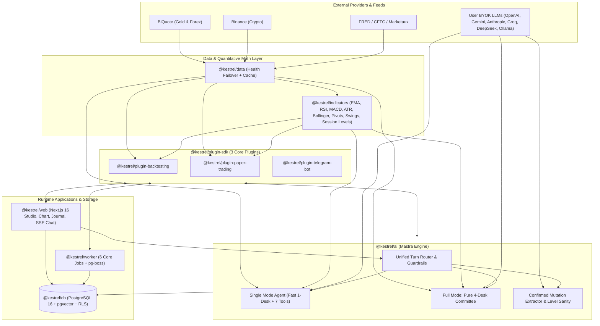
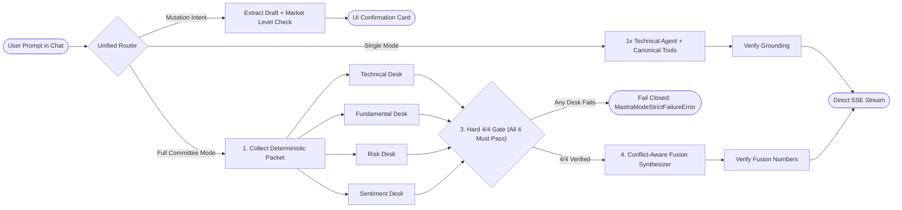
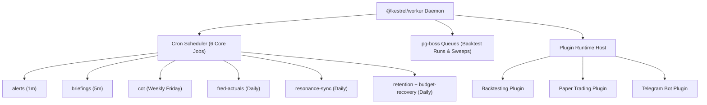

# Kestrel Open-Source & Architecture Simplification Roadmap

> **For AI Coding Agents (Claude Code, OpenCode, Codex, Cursor):**
> This directory contains the master architectural simplification and open-source readiness roadmap for **Kestrel**. Phases 1–7 are complete (`bc289984` → Phase 7). Phase 5–7 remediate the [2026-11-04 Full Monorepo Architecture & Product Audit](../audit/kestrel-full-architecture-and-product-audit-2026-11-04.md). After every task, run `pnpm check:guards`, `pnpm knip`, and `pnpm check:fast` to ensure zero broken imports, zero unused exports, and 100% compliance with `AGENTS.md`.

---

## 0. Progress Tracker

Last updated: **2026-11-04**

| Phase                                                                                                              | Status       | Completed  | Evidence                                                                                                                                                                                                                                                                               |
| :----------------------------------------------------------------------------------------------------------------- | :----------- | :--------- | :------------------------------------------------------------------------------------------------------------------------------------------------------------------------------------------------------------------------------------------------------------------------------------- |
| **Phase 1** — [Open-source security and auth hardening](./phase1-open-source-security-and-auth-hardening.md)       | **Complete** | 2026-11-03 | 4/4 tasks. `check:fast` 31/31 tasks, `knip` 0 findings, `check:guards` 7/7, web 1536 tests passed.                                                                                                                                                                                     |
| **Phase 2** — [Pure 4-desk committee and direct streaming](./phase2-pure-4-desk-committee-and-direct-streaming.md) | **Complete** | 2026-11-03 | 3/3 tasks. `check:fast` 31/31 tasks, `knip` 0 findings, `check:guards` 7/7, ai 1636 + db 102 + worker 320 + web 1516 tests passed.                                                                                                                                                     |
| **Phase 3** — [SMC removal and indicator modernization](./phase3-smc-removal-and-indicator-modernization.md)       | **Complete** | 2026-11-03 | 3/3 tasks. `check:fast` 31/31 tasks, `knip` 0 findings, `check:guards` 7/7, ai 1639 + shared 459 + indicators 84 + web 1516 + backtesting 64 tests passed.                                                                                                                             |
| **Phase 4** — [Plugin pruning and worker consolidation](./phase4-plugin-pruning-and-worker-consolidation.md)       | **Complete** | 2026-11-03 | 3/3 tasks. `check:fast` 29/29 tasks, `knip` 0 findings, `check:guards` 7/7, ai 1587 + db 101 + worker 306 + web tests passed.                                                                                                                                                          |
| **Phase 5** — [Security & functional bug fixes (P0/P1)](./phase5-security-and-functional-bug-fixes.md)             | **Complete** | 2026-11-04 | 6/6 tasks. Telegram chat authorization + thread persistence, BYOK memory settings lookup, IPv4-mapped SSRF + grounding regex, Journal crypto PnL/modal/cache, Alerts web-push + `indicatorCross` preview. `check:fast` 29/29, `knip` 0, guards 7/7.                                    |
| **Phase 6** — [AI engine, worker, market data & DB unification](./phase6-ai-worker-and-data-unification.md)        | **Complete** | 2026-11-04 | 5/5 tasks. Route accounting, budget cent rounding, compound opinion keys, paper-trading active-user caps, worker/web cron parity (news job, token purge, Mastra prune, partition filter), BiQuote `1w` synthesis, open `computeIndicator`, shared session windows, env/tenant hygiene. |
| **Phase 7** — [Web state sync, Docker/scripts & debloat](./phase7-web-state-tooling-and-debloat.md)                | **Complete** | 2026-11-04 | 4/4 tasks. Watchlist + gameplan DB sync (+ migration `0125`), Docker/script/doc fixes, `@kestrel/source` condition (patch deleted), dead schema cleanup (`0126`), maintainability caps raised with RULE-F03 retired.                                                                   |

### Phase 5 task status

| Task                                        | Status   | Delivered                                                                                                                                                                                                             |
| :------------------------------------------ | :------- | :-------------------------------------------------------------------------------------------------------------------------------------------------------------------------------------------------------------------- |
| **5.1** Enforce `linkedChatId`              | Complete | Every command, plain-text turn, and callback button is rejected unless the originating chat matches the linked chat; a bare `/start` cannot hijack an already-linked bot, while a valid one-time token still relinks. |
| **5.2** Telegram thread persistence & tools | Complete | Thread row is ensured before append (idempotent `createThread` id), history writes run after the reply via `afterSend`, failures are logged not surfaced, and `/ask` registers the public read-only tool belt.        |
| **5.3** BYOK memory & journal indexing      | Complete | `upsertMemory` loads `aiApiKeys`/`embeddingModel` when the caller omits them; chat-confirmed `log_journal` entries are indexed via `rememberJournalEntry` after commit.                                               |
| **5.4** SSRF & grounding hardening          | Complete | IPv4-mapped (`::ffff:`) and NAT64 (`64:ff9b:`) literals are blocked; bare timeframe units no longer exempt nearby prices from grounding.                                                                              |
| **5.5** Journal UX                          | Complete | Crypto contract size comes from the symbol catalog; the import form renders inside the parent drawer; AI coach/review outputs live in React Query cache keyed per trade.                                              |
| **5.6** Alerts delivery & preview           | Complete | `web-push` checkbox added; `indicatorCross` history is simulated with the same scalar/field selection as the live evaluator.                                                                                          |

### Phase 6 task status

| Task                                           | Status   | Delivered                                                                                                                                                                                                        |
| :--------------------------------------------- | :------- | :--------------------------------------------------------------------------------------------------------------------------------------------------------------------------------------------------------------- |
| **6.1** AI routing, failover, budget, opinions | Complete | Semantic routing only runs for canonical chat and accepts an accounting sink; paid sub-cent turns reconcile to 1 cent; comparison opinions use `desk:symbol` keys; env fallback keys honor the caller's env bag. |
| **6.2** Paper trading caps                     | Complete | Tick and market-watch caps count users with open positions/pending orders, not installation order.                                                                                                               |
| **6.3** Worker/web cron parity                 | Complete | Retention purges expired verification tokens; web cleanup runs budget recovery + Mastra pruning; briefings filter by tenant partition (shared `@kestrel/shared/tenant-partition`); worker schedules `news`.      |
| **6.4** Market data & indicators               | Complete | BiQuote synthesizes `1w` from `1d`; `computeIndicator` accepts plugin kinds; Marketaux tags the full 18-symbol catalog; session windows live in `@kestrel/indicators`.                                           |
| **6.5** Env, plugin intent & tenant cache      | Complete | `PHASE3_STRUCTURED_FUSION` defaults on; `CacheEnv` owns `REDIS_URL`; plugin chat intents come from manifests; `getTenantIdForUser` uses a bounded TTL cache.                                                     |

### Phase 7 task status

| Task                                     | Status   | Delivered                                                                                                                                                                                                              |
| :--------------------------------------- | :------- | :--------------------------------------------------------------------------------------------------------------------------------------------------------------------------------------------------------------------- |
| **7.1** Dashboard state sync             | Complete | Watchlist hydrates from `user_symbols` and persists add/remove through the symbols API; gameplan persists to `user_settings.session_gameplan` (migration `0125`) and is injected into the canonical chat risk context. |
| **7.2** Docker, scripts, docs            | Complete | `# syntax` on both Dockerfiles, `--env-file-if-exists`, `/health/live`, plugins in coverage, `MIGRATION_DATABASE_URL`, oxlint scaffolding, pnpm/DB/budget docs, loadtest app role.                                     |
| **7.3** Dependencies & artifacts         | Complete | `@kestrel/source` condition, `eventsource-parser` patch deleted, `jsdom`/dead seed scripts/`infra/` removed. `metrics-export` was retained: it is a live OTLP exporter used by run telemetry and the eval runner.      |
| **7.4** Schema cleanup & maintainability | Complete | Dead monthly/provider spend-alert columns + dead code removed (migration `0126`), `createPluginTable`/`listAllUserSettings` deleted, caps raised to 500/450 and RULE-F03 retired.                                      |

### Phase 1 task status

| Task                                                       | Status   | Delivered                                                                                                                                                                       |
| :--------------------------------------------------------- | :------- | :------------------------------------------------------------------------------------------------------------------------------------------------------------------------------ |
| **1.1** Mask BYOK keys at the RSC boundary                 | Complete | Server-built `••••1a2b` previews, empty = keep, explicit `***REMOVE***` action, payload regression test.                                                                        |
| **1.2** First-user registration and operator-key isolation | Complete | `first_user` default, atomic admin promotion, OAuth parity, `ALLOW_SHARED_OPERATOR_KEYS=0` default, budget cap on.                                                              |
| **1.3** Lock down `/api/cron/*`                            | Complete | 16+ character secret in constant time, admin-only browser sessions, user refresh moved to `/api/news/refresh` and `/api/calendar/refresh`.                                      |
| **1.4** Money exactness and RLS role wiring                | Complete | Money columns on `numeric(20, 8)` (migration `0121`), Compose always connects as `kestrel_app`, migrations run as the schema-owning superuser, app role re-provisioned on boot. |

**Phase 1 exit gate:** `pnpm check:guards`, `pnpm knip`, and `pnpm check:fast` all pass. Operator action for existing deployments: add `POSTGRES_APP_PASSWORD` to `.env` and decide whether to keep `REGISTRATION_MODE=first_user` (default) or set `open`.

### Phase 2 task status

| Task                                                                     | Status   | Delivered                                                                                                                                                                                                   |
| :----------------------------------------------------------------------- | :------- | :---------------------------------------------------------------------------------------------------------------------------------------------------------------------------------------------------------- |
| **2.1** Remove the JEV decision-model subsystem                          | Complete | `packages/ai/src/jev/` and every JEV hook deleted (routing, guardrails, RAG, setup, evals, settings UI, env keys, BYOK fields). `rg -i "jev" packages apps` returns zero matches.                           |
| **2.2** Pure 4-desk committee, strict 4/4 gate, no critique/debate/Brier | Complete | Workflow is `collect-packet → parallel(4 desks) → verify → fusion`. Missing/failed desks fail closed. Conflict-aware fusion prompt. Critique/debate/Brier modules and worker calibration jobs deleted.      |
| **2.3** Stream `full` over SSE and retire `full_analysis_queue`          | Complete | Both modes run through `runResearchWorkflow → runMastraModeChatStream`. Queue route, worker job, DB queries/schema, queue health/SLI, and UI polling deleted. Migration `0123` drops `full_analysis_queue`. |

**Phase 2 exit gate:** `pnpm check:guards` (7/7), `pnpm knip` (0 findings), and `pnpm check:fast` (31/31 tasks) all pass. `rg -i "jev" packages apps` and `rg "full_analysis_queue|analysis-jobs"` return no source matches.

### Phase 3 task status

| Task                                                       | Status   | Delivered                                                                                                                                                                                                                                |
| :--------------------------------------------------------- | :------- | :--------------------------------------------------------------------------------------------------------------------------------------------------------------------------------------------------------------------------------------- |
| **3.1** Prune heuristic SMC detectors                      | Complete | `fvg.ts`, `order-blocks.ts`, `liquidity.ts`, `structure.ts` and their tests deleted. `StructureResult` carries `swings` only; `computeStructure` no longer takes `kinds`. Swings, PDH/PDL, and Asian range stay.                         |
| **3.2** Clean tools, packet, and backtester feature matrix | Complete | `get_market_structure` returns swings + `recentSwingHigh`/`recentSwingLow`/`rangeSize` + summary. `analyze_technical` drops BOS/CHoCH and adds PDH/PDL/Asian levels. Backtester `ctx.levels` exposes levels only; SMC playbook replaced. |
| **3.3** Documentation and UI copy                          | Complete | README, OG image, landing sections, chat prompts, desk briefs, and specialist playbooks describe multi-timeframe quantitative structure and session levels. BiQuote documented as the default gold/FX provider.                          |

**Phase 3 exit gate:** `pnpm check:guards` (7/7), `pnpm knip` (0 findings), and `pnpm check:fast` (31/31 tasks) all pass. `rg -i "\bbos\b|choch|\bfvg\b|fair value gap|order block|liquidity sweep|\bsmc\b"` returns no source or copy matches outside the roadmap history.

### Phase 4 task status

| Task                                                  | Status   | Delivered                                                                                                                                                                                                                                                                                    |
| :---------------------------------------------------- | :------- | :------------------------------------------------------------------------------------------------------------------------------------------------------------------------------------------------------------------------------------------------------------------------------------------- |
| **4.1** Remove `@kestrel/plugin-custom-agents`        | Complete | Plugin package, Agent Studio UI/API, MCP bridge, chat `agentSlug` plumbing, AI agent runtime, `agentCatalogs` SDK hooks, and Telegram `/agents` deleted. Migration `0124` drops the plugin tables.                                                                                           |
| **4.2** Delete enterprise bloat subsystems            | Complete | `persistence_outbox` + replay worker deleted (writers use `withDbRetry` + log), ML dataset export (`dataset-export`, `eval_datasets`, `ai_regression_cases`, Langfuse publishing, admin routes) removed, `memory_projection_state` and `notification_noise_state` dropped. Migration `0124`. |
| **4.3** Consolidate the worker and deployment scripts | Complete | Worker runs `alerts`, `briefings`, `cot`, `fred-actuals`, `resonance-sync`, `retention` (+ optional `embedding-backfill`). `budget-recovery` folded into retention, `metrics-flush`/remote-write removed, `botkeep.sh` and `infra/cron-vm/` deleted, `DEPLOY.md` rewritten.                  |

**Phase 4 exit gate:** `pnpm check:guards` (7/7), `pnpm knip` (0 findings), and `pnpm check:fast` (29/29 tasks) all pass. `rg -i "custom-agents|persistence_outbox|eval_datasets|ai_regression_cases|memory_projection_state|notification_noise_state"` returns no live source matches outside migrations and roadmap history.

---

## 1. Product Vision & Owner Decisions (Locked 2026-11-03)

Kestrel is transitioning from an over-engineered internal prototype into a **clean, fast, open-source self-hosted AI trading research & execution platform** for Gold (`XAUUSD`), Forex, and Crypto.

### Core Product Loop (What Stays & Shines)

1. **Live Market Terminal & Charting (`@kestrel/web`, `@kestrel/data`):**
   - TradingView Pro chart view (`/chart/[symbol]`), Economic Calendar (`/calendar`), News (`/news`), and Trade Journal (`/journal`).
   - Out-of-the-box market data powered by **BiQuote** (Gold & Forex), **Binance** (Crypto), **FRED** (Macro & Real Yields), **CFTC** (Commitment of Traders), and **Marketaux / Finnhub** with health-scored failover (`packages/data/src/failover.ts`).
2. **True 4-Desk Multi-Agent AI Research (`@kestrel/ai` on Mastra):**
   - **`single` mode:** Fast (~1–2s) single-agent response with the 7 canonical read-only market tools.
   - **`full` mode (Pure 4-Desk Committee):** Deterministic research packet collection → **4 parallel specialist desks** (`technical`, `fundamental`, `risk`, `sentiment`) → **Strict 4-of-4 Hard Gate** (all 4 agents must succeed and pass deterministic numeric grounding verification; zero partial answers) → **1 Conflict-Aware Fusion Synthesizer** streamed **directly over SSE** (`runMastraModeChatStream`).
3. **Modular Plugin Architecture (`@kestrel/plugin-sdk` + 3 Official Plugins):**
   - Keep `@kestrel/plugin-sdk` so capabilities remain modular and isolated.
   - Keep the **3 core trader plugins**:
     1. `@kestrel/plugin-backtesting` (deterministic bar-by-bar strategy engine & sweeps)
     2. `@kestrel/plugin-paper-trading` (virtual margin/leverage broker & position simulator)
     3. `@kestrel/plugin-telegram-bot` (per-user BotFather wizard, alerts, and daily briefings)
4. **Two Clean Deployment Targets:**
   - **Self-Hosted Docker Compose (`docker-compose.yml`):** 1-command setup for open-source users.
   - **Vercel + Supabase (`DEPLOY.md`):** Cloud setup for personal/hosted deployment.

---

## 2. Target System & Workflow Graphs

### 2.1 End-to-End Monorepo & Runtime Architecture



### 2.2 Pure 4-Desk AI Committee & Direct SSE Flow (`/api/chat`)



### 2.3 Consolidated Worker & Plugin Architecture



---

## 3. What We Are Cutting (And Why)

| Removed Subsystem                                              | Key Paths to Remove                                                                                                                                                                          | Why It Is Being Cut                                                                                                                                                                                                                                                                       |
| :------------------------------------------------------------- | :------------------------------------------------------------------------------------------------------------------------------------------------------------------------------------------- | :---------------------------------------------------------------------------------------------------------------------------------------------------------------------------------------------------------------------------------------------------------------------------------------- |
| **JEV SystemOne Decision Layer**                               | `packages/ai/src/jev/`, `jev-packet-scorer.ts`, `jev-consensus-gate.ts`, `jev-calibration-block.ts`, `jev-scorers.ts`, `jev-decision-keys*`                                                  | External decision-model dependency (`OPENCODE` / `TYPESAFE` / `LIQUID`) that overrides 70% of LLM confidence scores and adds 3 network hops + BYOK friction for open-source users.                                                                                                        |
| **Committee Critique & Debate Rounds**                         | `packages/ai/src/committee/critique/`, `critique-steps.ts`                                                                                                                                   | Adds 8 extra sequential LLM calls per `full` run and causes specialist "groupthink" before Fusion. The Fusion Synthesizer should resolve conflicts directly across the 4 independent desk opinions.                                                                                       |
| **Async `full_analysis_queue` & Worker Polling**               | `packages/db/src/schema/ai/full-analysis-queue.ts`, `packages/db/src/queries/full-analysis-queue/`, `apps/worker/src/jobs/multi-agent-analysis/`, `apps/web/src/app/api/chat/analysis-jobs/` | Without JEV + Critique + Debate, the 4-Desk Committee finishes in ~8–15s and streams **directly** over SSE via `runMastraModeChatStream`. No polling queue is needed.                                                                                                                     |
| **Legacy SMC Heuristics (`OB`, `FVG`, `BOS/CHoCH`, `Sweeps`)** | `packages/indicators/src/smc/fvg.ts`, `order-blocks.ts`, `liquidity.ts`, `structure.ts`                                                                                                      | Heuristic SMC boxes/gaps are noisy for LLMs. Remove them for now; keep objective mathematical indicators (`EMA`, `SMA`, `RSI`, `MACD`, `ATR`, `Bollinger`, `Pivots`) and clean price levels (`swings.ts`, `pdh-pdl.ts`, `asian-range.ts`) until better quantitative indicators are added. |
| **`@kestrel/plugin-custom-agents`**                            | `plugins/custom-agents/`, `apps/web/src/lib/services/plugin-custom-agents.ts`, `custom-agent-dispatch.ts`                                                                                    | Scope creep ("no-code custom chatbot builder"). Kestrel is a focused trading platform, not a generic agent builder.                                                                                                                                                                       |
| **Brier Opinion Calibration & ML Exports**                     | `calibration-weights.ts`, `opinion-calibration.ts`, `dataset-export.ts`, `eval_datasets`, `ai_regression_cases`                                                                              | Nightly Backblaze B2 JSONL exports and hourly Brier-score grading against 1m candles are unused enterprise bloat.                                                                                                                                                                         |
| **Transactional Outbox & Extra Jobs**                          | `persistence-outbox.ts`, `persistence-recovery.ts`, `metrics-flush.ts`, `botkeep.sh`, `infra/cron-vm/`                                                                                       | Reduces background worker jobs from 15 down to 6 essential trader jobs (`alerts`, `briefings`, `cot`, `fred-actuals`, `resonance-sync`, `retention`).                                                                                                                                     |

---

## 4. Roadmap Phases & Execution Order

| Phase       | Document                                                                                                         | Summary                                                                                                                                                                                           |
| :---------- | :--------------------------------------------------------------------------------------------------------------- | :------------------------------------------------------------------------------------------------------------------------------------------------------------------------------------------------ |
| **Phase 1** | [`phase1-open-source-security-and-auth-hardening.md`](./phase1-open-source-security-and-auth-hardening.md)       | Fix plaintext BYOK key exposure on `/settings/api-keys`, lock registration after first admin user (`first-user` mode), enforce `CRON_SECRET`/admin on `/api/cron/*`, and fix float money columns. |
| **Phase 2** | [`phase2-pure-4-desk-committee-and-direct-streaming.md`](./phase2-pure-4-desk-committee-and-direct-streaming.md) | Delete JEV, Critique, Debate, and Brier calibration; keep the strict 4-of-4 specialist hard gate; stream `full` mode directly over SSE; retire `full_analysis_queue`.                             |
| **Phase 3** | [`phase3-smc-removal-and-indicator-modernization.md`](./phase3-smc-removal-and-indicator-modernization.md)       | Remove legacy SMC detectors (`OB`, `FVG`, `BOS/CHoCH`, `Liquidity Sweeps`), keep clean swing/session levels + classic indicators, and update AI tools, backtester, and docs.                      |
| **Phase 4** | [`phase4-plugin-pruning-and-worker-consolidation.md`](./phase4-plugin-pruning-and-worker-consolidation.md)       | Remove `@kestrel/plugin-custom-agents`, delete `persistence_outbox` and ML dataset export tables/jobs, reduce worker jobs from 15 to 6, and remove legacy Botkeep/VM scripts.                     |

See also the **2026-11-04 Full Monorepo Audit** (`docs/audit/kestrel-full-architecture-and-product-audit-2026-11-04.md`) and its three follow-up phases:

- **Phase 5:** [`phase5-security-and-functional-bug-fixes.md`](./phase5-security-and-functional-bug-fixes.md)
- **Phase 6:** [`phase6-ai-worker-and-data-unification.md`](./phase6-ai-worker-and-data-unification.md)
- **Phase 7:** [`phase7-web-state-tooling-and-debloat.md`](./phase7-web-state-tooling-and-debloat.md)

---

## 5. Mandatory Agent Verification Protocol

After completing each task inside any phase:

```bash
# 1. Run static architecture, route-security, env-contract, and file-size guards
pnpm check:guards

# 2. Run dead-code and unused-export check (must report 0 findings)
pnpm knip

# 3. Run Rust linter, formatter check, and affected typecheck + unit tests
pnpm check:fast
```

**Hard Rules Reminder (`AGENTS.md`):**

- Never weaken or edit `scripts/check-*.mjs`, `knip.json`, or `.oxlintrc.json` to silence a failure.
- Backend `.ts` files must stay `<= 500` LOC; React `.tsx` files must stay `<= 450` LOC. Keep cohesive components whole instead of splitting them into micro-files.
- Never leave pass-through re-export shims; update callers directly and delete dead files.
